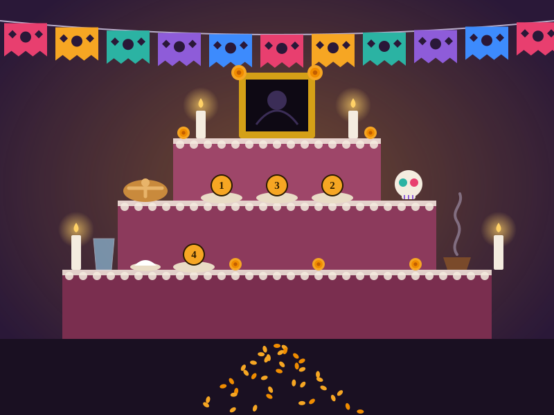

# Ofrenda local

> Tell it about someone you miss and get a short remembrance, a *calaverita*, a checklist for their *ofrenda* and an image of how the altar could look. The AI runs on your own computer, with no internet: your stories and photos never leave your machine.

Built for the **Hacktoberfest Open-Source AI Challenge, Week 4: Ghost in the Machine** (Día de Muertos).

- Post on DEV: [[TODO: add link once published]]
- Demo video: [VIDEO](https://youtu.be/DrP-kSJcx5c)



---

## What it does

1. You write a few things about a loved one: name, what they were to you, favorite food, a song, a memory, and the tone you want (tender, cheerful or solemn). A photo is optional.
2. A local Gemma 3 model writes, in Mexican Spanish:
   - a short **remembrance** addressed to them,
   - a **calaverita literaria** (affectionate, never cruel),
   - a one-line **cartelito** for a papel picado or a card,
   - **personal items** for the ofrenda taken only from what you told it,
   - if you added a photo, a plain description of what is visible (it never identifies anyone).
3. The app also lists the traditional elements of an ofrenda (cempasúchil, candles, papel picado, water, salt, pan de muerto, copal, a portrait) with their meaning. That text is fixed in the code, not generated, so the cultural content does not depend on a small model.
4. A local image model then paints **how the altar could look**, using the traditional elements plus the personal items. The image never shows people; your photo is not sent to the image model. Ollama image models need MLX (a Mac with Apple Silicon, or Linux with an NVIDIA GPU). On other computers the app draws its own illustration of the altar instead, with numbered plates for the personal items.
5. You edit everything, copy it, download the image, or **print a sheet** for your ofrenda.

The model is a drafting aid. It is told to use only the data you provide and never to invent facts about the person.

## Why open-source AI

- **Privacy.** Family stories and photos are among the most personal data there is. Here they go from your browser to a server on your machine to a model on the same machine.
- **Works offline.** Once the model is downloaded, no internet is needed.
- **No service to disappear.** It does not depend on someone else's API, pricing or terms.
- **Control.** The output shape is enforced with a JSON schema, the prompt is a plain text file, and the model can be swapped with one environment variable.

## How it works

```
Browser (React + Vite)
   │  form + optional photo
   ▼
Express API (TypeScript)      POST /generate-ofrenda
   │  system prompt + user data + JSON schema in Ollama's `format`
   ▼
Ollama  ──►  Gemma 3 (vision-capable, open weights), running locally
   │  structured JSON
   ▼
Validation + normalization  ──►  editable result, printable sheet
   │  personal items + tone
   ▼
POST /generate-altar-image  ──►  Ollama image model (x/z-image-turbo)  ──►  altar illustration
```

- Structured output: the schema in [`schema.json`](schema.json) is passed to Ollama's `format` parameter, so the model must answer with the expected fields.
- The server validates the response again, trims lengths and reports warnings (for example, a calaverita that came out too short).
- The system prompt ([`prompts/system.txt`](prompts/system.txt)) tells the model to treat the user's text as data, not as instructions.

## Getting started

### Prerequisites

- [Ollama](https://ollama.com/download)
- Node.js 20+
- About 16 GB of RAM is comfortable for `gemma3:4b`.

### Run it

```bash
ollama pull gemma3:4b
ollama pull x/z-image-turbo
npm install
npm run dev
```

Open http://localhost:5173. `npm run dev` starts the API (port 3001) and the web app together. Writing takes roughly 20 to 60 seconds on a laptop; the altar image is generated afterwards and can take a few minutes. Image generation needs a recent Ollama and enough GPU/unified memory; if it is not available (for example `this model requires MLX support`), the app shows its own drawing of the altar and everything else still works.

For better verses you can try a larger model:

```bash
ollama pull gemma3:12b
OLLAMA_MODEL=gemma3:12b npm run dev
```

### Running on WSL with Ollama on Windows

If Ollama is installed in Windows and the project runs in WSL, make `localhost` shared by creating `C:\Users\<you>\.wslconfig`:

```
[wsl2]
networkingMode=mirrored
```

Then run `wsl --shutdown` in PowerShell, reopen Ubuntu and check `curl http://localhost:11434` answers `Ollama is running`. Alternatively, set `OLLAMA_URL` to the Windows host address.

### Configuration

| Variable | Default | Description |
|---|---|---|
| `OLLAMA_URL` | `http://localhost:11434` | Where Ollama is running |
| `OLLAMA_MODEL` | `gemma3:4b` | Model used for writing |
| `PORT` | `3001` | API port |
| `OLLAMA_TIMEOUT_MS` | `240000` | Max wait for the model |
| `OLLAMA_IMAGE_MODEL` | `x/z-image-turbo` | Model used for the altar image |
| `OLLAMA_IMAGE_TIMEOUT_MS` | `600000` | Max wait for the image |
| `OLLAMA_IMAGE_WIDTH` / `OLLAMA_IMAGE_HEIGHT` | `1024` / `768` | Image size |
| `CORS_ORIGIN` | any | Restrict allowed origins when deploying |

## API

`POST /generate-ofrenda` (multipart/form-data)

| Field | Required | Notes |
|---|---|---|
| `name` | yes | Max 60 chars |
| `relationship`, `food`, `song` | no | Max 60 / 120 / 120 chars |
| `story` | no | Max 800 chars |
| `tone` | no | `Tierno`, `Alegre` or `Solemne` |
| `photo` | no | One JPG, PNG or WEBP, max 8 MB |

```bash
curl -F "name=Abuela Chuy" -F "relationship=mi abuela" -F "food=mole" -F "tone=Tierno" \
  http://localhost:3001/generate-ofrenda
```

Response: `{ ofrenda, traditional, warnings, meta }`.

`POST /generate-altar-image` (JSON): `{ "tone": "Alegre", "items": ["Mole", "A guitar"] }` → `{ image, meta }`, where `image` is a PNG data URL.

 `GET /health` reports whether Ollama is reachable and the model is downloaded.

## Project structure

```
.
├── schema.json          # JSON schema sent to Ollama
├── prompts/system.txt   # System prompt
├── server/              # Express API (config, Ollama client, validation, traditional elements)
├── src/                 # React interface
├── docs/                # Screenshot
└── index.html, vite.config.ts, tsconfig.json
```

## Limitations

- A 4B model writes Spanish verse that rhymes unevenly. Treat the output as a draft and edit it.
- It only knows what you tell it. With little input, the text is more generic.
- It is not a grief-support tool; it is a small writing aid for a tradition.
- Photos are described, never identified.
- Tested by the author only so far. [[TODO: update if you test it with other people]]

## Roadmap

- [x] Local generation with structured output
- [x] Optional photo description
- [x] Editable result and printable sheet
- [x] Local image of how the altar could look
- [ ] Voice recording and local transcription of family stories (open-weight speech model)
- [ ] Save an ofrenda as a shareable page
- [ ] Fine-tune a model on real calaveritas for better rhyme

## License

[MIT](LICENSE) · Built by **Nora Aguirre**
